<!-- Every card is an animated SVG drawn by scripts/render_readme_cards.py from real
     GitHub data (scripts/fetch_contributions.py) and refreshed daily by
     .github/workflows/update-profile-art.yml. Design: "Agent Worlds" -- dark violet,
     cyan and amber, matched to my tokyonight streak card. Spacing is baked into the
     SVGs, so keep this block free of blank lines and keep the cards in a row on one
     line with no spaces between them. -->

 
 
 
 
 
 

## About Me

- I build **autonomous AI agents** and **voice AI** — agents that research, reason and *act*, not just chat
- Computer Science student from **Kerala, India**, shipping solo on an entirely free stack
- Deep into multi-agent systems, RAG pipelines and agent verification right now
- Motto: *ship it, then make it smarter*

## More Projects

| Project | What it does |
|---|---|
| [**Cozy Coffee**](https://github.com/nithincodesx/Cozy-Coffee-v1) | Full-stack community app for coffee enthusiasts — share brews, review cafés, join forum discussions. |
| [**CloudPulse AI**](https://github.com/nithincodesx/CloudPulse-AI) | SaaS-style dashboard tracking real-time server utilization, budget anomalies and idle infrastructure, with telemetry in Supabase. |
| [**MediLink AI**](https://github.com/nithincodesx/MediLink-AI) | AI-powered healthcare linking, built with Python. |

## Contribution Snake

  

<a href="https://github.com/nithincodesx?tab=followers">followers</a> &nbsp;/&nbsp; <a href="https://github.com/nithincodesx?tab=repositories">all repos</a> &nbsp;/&nbsp; <a href="https://github.com/nithincodesx/Coraxis">coraxis</a> &nbsp;/&nbsp; <a href="https://github.com/nithincodesx/ammacare">ammacare</a>

Cards generated from my real contribution data by scripts in this repo. Animated-SVG-card design inspired by <a href="https://www.avivashishta.com/blog/github-profile-readme-animated-svg-cards">Avi Vashishta's README guide</a>. Thanks for stopping by — if an agent of mine sent you here, say hi.

